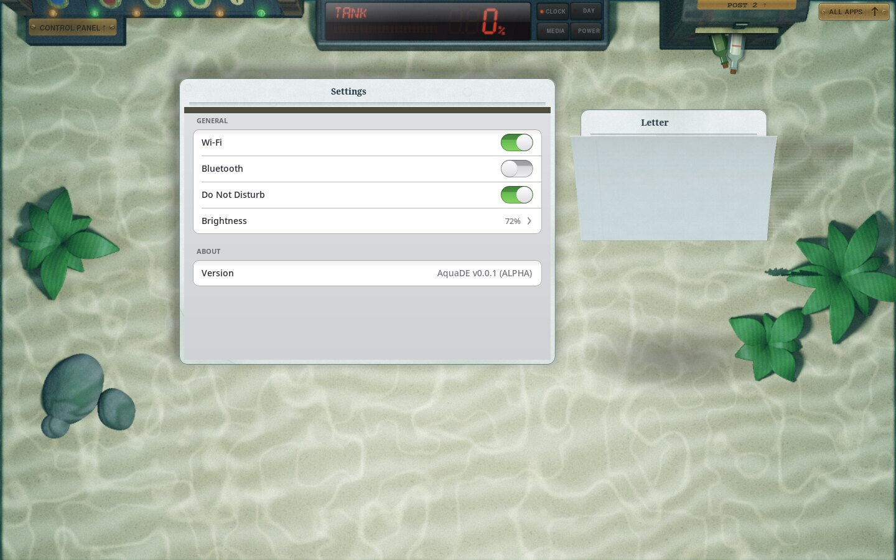
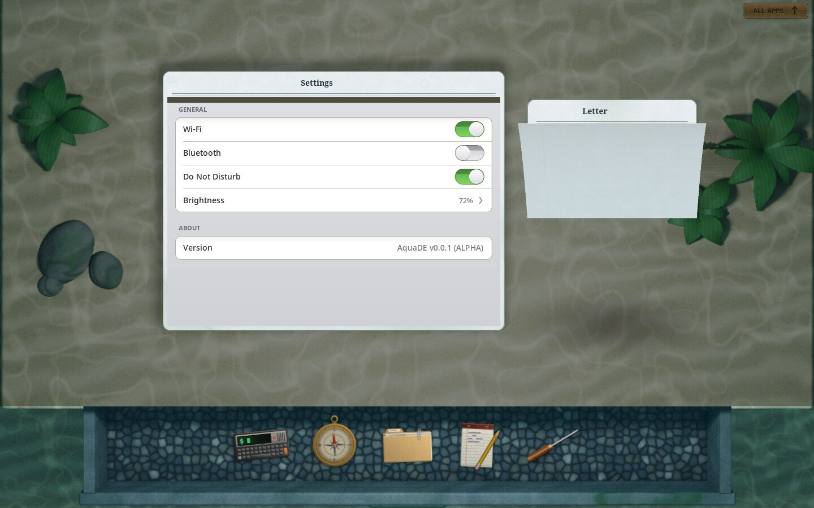
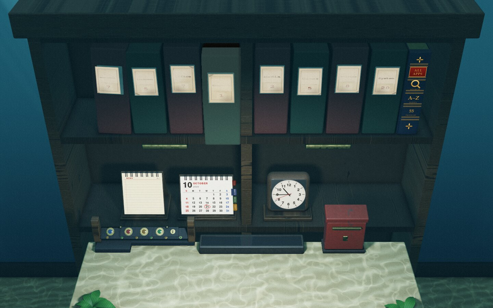
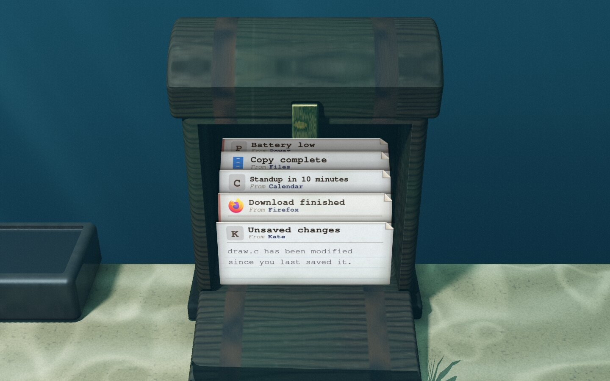
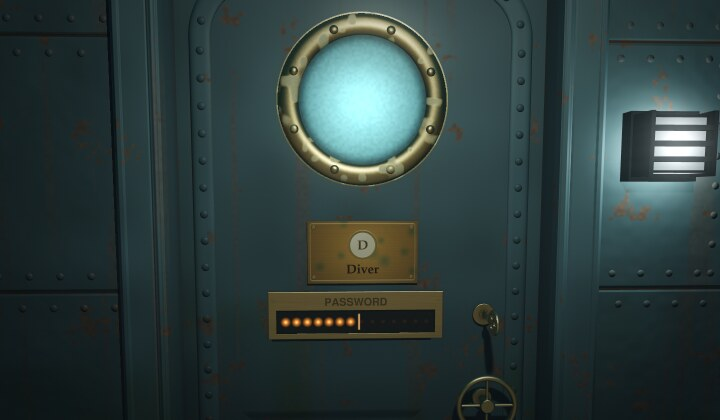
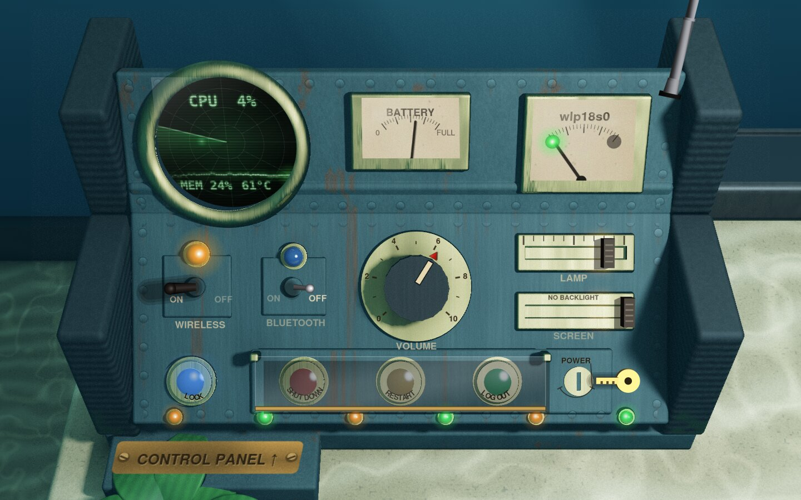
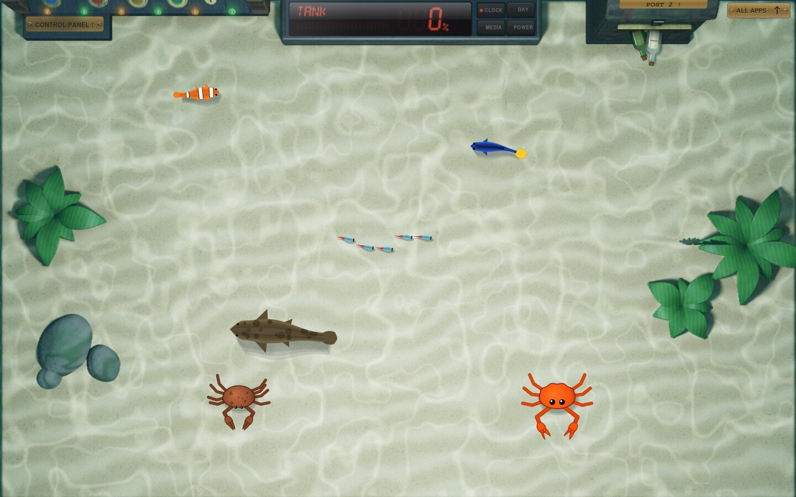

# AquaDE

**v0.0.1 (ALPHA)** -- a Wayland desktop for Linux that lives at the bottom of
an aquarium.

Windows are sheets of diver's plastic lying on rippled sand, the dock is a
slate drawer full of gravel, your apps are seashells on a sunken bookcase,
notifications wash up in a treasure chest, and the lock screen is a
submarine's watertight door. The whole tank is ray-traced and lit from above
by light coming down through the water.



> **Status: alpha.** AquaDE is a work in progress. It builds, runs and is
> tested in a window inside another desktop, but it has not been installed
> as a full session on real machines yet. Expect rough edges.

## Built on DEsk

AquaDE is a fork of [DEsk](https://github.com/fyzugx/DEsk) by fyzugx, a
skeuomorphic desktop where everything is a real desk, and it takes its
inspiration from it. DEsk's compositor, notification daemon, system tray,
settings, app scanning and translations do the real work underneath. AquaDE
replaces the room and the things in it with an aquarium. Thank you to
fyzugx for making DEsk and releasing it under the MIT licence.

## What's in the tank

- **Windows are diver's plastic.** Each window sits on a white plastic sheet
  with a dog-eared corner. Hold the pointer on the corner to lift it and see
  **Fold** (minimise), **Unfold / Refold** (maximise and restore) and
  **Discard** (close) on the back.
- **A shark eats closed windows.** A closed window is crumpled into a ball,
  and a shark swims in, eats it and swims off, all in about a second. Now
  and then it's a grouper instead, and small windows get a pufferfish. You
  can turn it off in Shell Settings.
- **The dock is a drawer.** Pull the handle (or press `Super+D`) for a slate
  drawer lined with gravel. It holds any app or a folded window.
- **Your apps are seashells.** Look up at the sunken slate bookcase
  (`Super+A`): each category is a shell that opens to show its apps, and at
  the end of the row the ALL APPS book lists every program from A to Z, with
  a search line.
- **Notifications are in a treasure chest** (`Super+N`). Unread ones stick
  out of the chest as messages in bottles. Open it and the letters inside
  show who sent them and what they say.
- **The lock screen is a watertight door** (`Super+L`): riveted steel hull
  plates, a brass porthole, your name on a brass plate and a caged bulkhead
  lamp. Type your password, and the wheel turns and the door swings open
  into the tank. Passwords are checked with PAM, as at login.
- **It sounds like it's under water.** Sounds are muffled, the drawer
  grinds over gravel, letters and the chest let out bubbles, and the shark
  chomps.
- **Fish and crabs.** Now and then a clownfish, a blue tang, a school of
  neon tetras or a slow grouper swims across the tank, and a crab walks over
  the sand, stopping to wave its claws. One crab in three is Ferris, Rust's
  crab, drawn our own way. They swim under the windows, so they never get in
  the way, and you can turn them off in Shell Settings.
- **Bubbles** rise from the stones and plants. They're animated over the
  traced tank and pause when you aren't using the computer (with the fish,
  about 5-10% of one CPU core while they're moving). You can turn them off
  in Shell Settings.
- **Light.** The tank (sand with caustics, light shafts through deep water,
  stones, rosette plants, ribbon grass) is ray-traced on the GPU (GLES 3),
  with a CPU fallback, and cached for each screen size.
- **The Control Panel is a submarine's control station** (`Super+C`):
  riveted hull-steel panels with rust running down from the rivets, ribbed
  rubber bumpers, brass-ringed gauges, and a sonar screen whose sweep goes
  round over the CPU trace. From it you set volume, Wi-Fi, Bluetooth,
  brightness and the power buttons, and the system tray hangs under it.
- **Also on the shelf:** a calendar with sticky notes, a memo pad and a
  clock.
- **Icons for the tank.** Files and folders in your file manager are drawn
  to match: sea-green plastic folders, white plastic pages, a hermit crab's
  shell for Home, a crab pot for the trash, a treasure chest for packages
  and a sonar set for the computer.
- **The rest of a full desktop:** more than one screen, X11 apps through
  Xwayland, an input method (IBus), screen-off and locking when idle, and
  seven languages (English, Japanese, Chinese, Korean, Spanish, French,
  German).

| The drawer, pulled out | The sunken bookcase |
| --- | --- |
|  |  |
| **The treasure chest, open** | **The lock screen** |
|  |  |





## Still to come

- Testing a real install, logged in as a full AquaDE session.
- The GTK theme for other programs' windows is still DEsk's (paper, ink and
  brass).

## Requirements

- wlroots 0.18
- wayland, wayland-protocols, xkbcommon, cairo, pixman, fontconfig, libdrm,
  PAM
- libsystemd (optional): the notification daemon and the system tray
  (`-Dpost=disabled` leaves them out)
- libpulse (optional): sounds (`-Dsound=disabled`)
- libinput (optional): touchpad and mouse settings
- EGL, GLES, gbm (optional): ray-trace the tank on the GPU. Without them the
  CPU does it.
- Xwayland and xcb (optional): X11-only apps
- Fonts: the URW base 35 (`fonts-urw-base35`) and Noto CJK
  (`fonts-noto-cjk`); `fonts-klee` for the memo pad
- At run time: `grim` for screenshots

A GPU isn't required. Without one, the first start takes a long time
tracing the tank, and after that it's cached.

## Build and run

If your distribution has wlroots 0.18:

```sh
meson setup build
meson compile -C build
```

If it doesn't (Arch only has 0.20), build wlroots 0.18.3 into `deps/wlroots`
and point the build at it:

```sh
W=$PWD/deps/wlroots
PKG_CONFIG_PATH=$W/lib/pkgconfig meson setup build -Dc_link_args="-Wl,-rpath,$W/lib"
meson compile -C build
```

Then try it:

```sh
./build/aquade-preview -o out.png -s 1440x900   # a picture of the tank, no compositor needed
./scripts/aquade-window                         # AquaDE in a window inside your current desktop
```

## Install

> The installers came from DEsk and have been renamed for AquaDE, but they
> haven't been tested on a real install yet. Running AquaDE in a window
> (above) is the safe way to try it for now.

From a clone of this repository, run the line for your system:

```sh
sudo sh scripts/install_debian.sh   # Debian 13
sudo sh scripts/install_ubuntu.sh   # Ubuntu 24.04 / 26.04, Mint, Pop!_OS
sudo sh scripts/install_arch.sh     # Arch, EndeavourOS, Manjaro
sudo sh scripts/install_fedora.sh   # Fedora 43 / 44, Nobara
```

Each one shows what it will install and asks first (`--no-apps` skips the
recommended programs, `--bare` installs AquaDE alone). Then log out and
choose **AquaDE** on the login screen. `sudo sh scripts/uninstall.sh` removes
it again. Your own settings in `~/.config/aquade` are left alone.

## Keys

| Key | |
| --- | --- |
| `Super+Enter` | terminal |
| `Super+Q` / `Alt+F4` | close the focused window (the shark gets it) |
| `Super+M` | fold / unfold the focused sheet |
| `Super+D` | open / close the drawer |
| `Super+A` | look up at the bookcase |
| `Super+C` | the Control Panel |
| `Super+N` | the treasure chest (notifications) |
| `Super+F` | the focused window full screen, and back (games) |
| `Alt+Tab` / `Super+Tab` | cycle windows |
| `Esc` | back to the tank floor |
| `Print` / `Alt+Print` | screenshot of the screen / of the front window |
| `Super+L` | lock the screen |
| `Super+Esc` / `Alt+Esc` | log out |

If something gets stuck, press Ctrl+Alt+Del twice, or run `aquade-ctl reset`
from a terminal. Either one redraws everything without closing your windows.

## Settings and documentation

Shell Settings (`aquade-settings`, or the screwdriver in the drawer) holds
AquaDE's own settings, including the shark, the bubbles and the fish, and opens the
usual programs for networks, sound, displays and so on. Settings are kept in
`~/.config/aquade/shell.conf`.

More detail:

- [docs/ARCHITECTURE.md](docs/ARCHITECTURE.md): how it's built (the
  compositor, the ray-traced tank, threads, files)
- [docs/MODDING.md](docs/MODDING.md): changing it (words, settings, sounds,
  the tank, new creatures)
- [docs/CONFIGURATION.md](docs/CONFIGURATION.md): every setting, file and
  environment variable

## Reporting a problem

Open an issue at
[github.com/PerrySJ/AquaDE/issues](https://github.com/PerrySJ/AquaDE/issues).
Running `aquade-report` writes `~/aquade-report.txt` with your version, Linux,
graphics card and the last session's log (your user name, home folder,
machine name and network addresses are taken out). Read it through, then
attach it. If you can't run it, attach `~/.local/state/aquade/session.log`
instead.

## How it was made

AquaDE was built with the help of AI. Much of the code and the documentation
was written by Claude (Anthropic's AI model) under the author's direction:
the author decided what AquaDE should be and how it should look, tested it,
and reviewed what went in. DEsk, which it is forked from, was made the same
way. Reports and patches are welcome all the same.

## License

AquaDE is free and open source software under the [MIT licence](LICENSE),
the same licence as DEsk, and it will stay free and open source.
